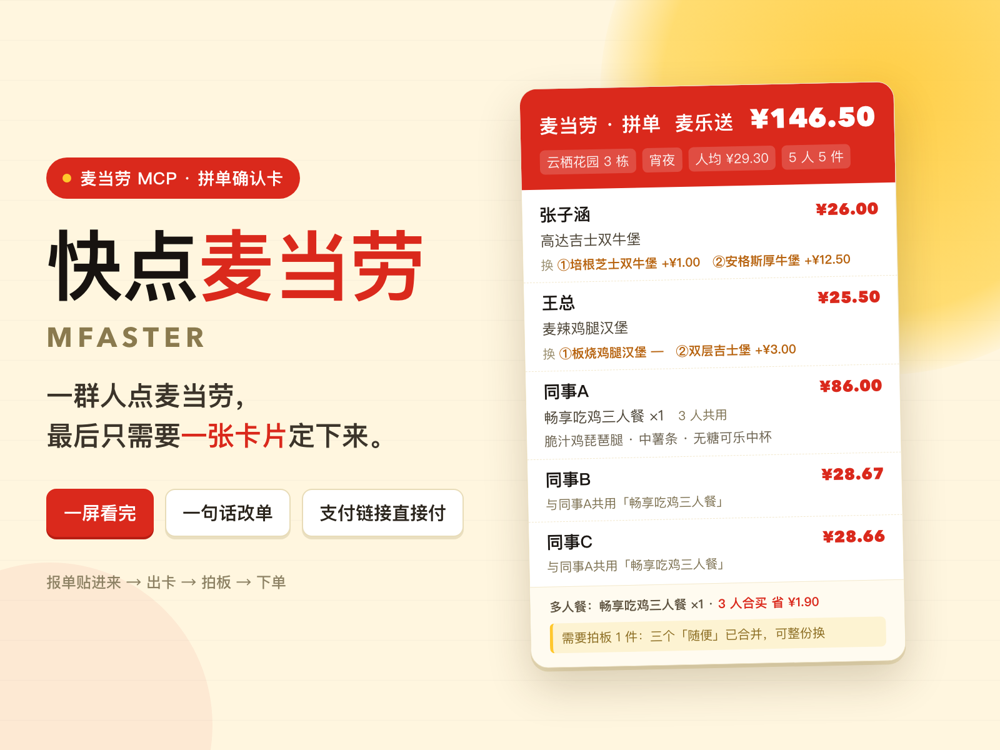

# 快点麦当劳 · Mfaster



**一句话介绍**：把群里零散的点餐报单，变成一张会话里一屏看完、每人扫到自己那行就能拍板的拼单确认卡——自带备选、一句话改单，确认后直接给支付链接。

这个 Skill 干的就是这件事：把群里零散的一句话需求，变成一张能看、能改、能直接下单的确认单。

```
麦当劳 · 拼单   麦乐送                          ¥146.50
云栖花园 3 栋 502   宵夜   人均 ¥29.30   5 人 5 件

张子涵      高达吉士双牛堡                              ¥26.00
王总        麦辣鸡腿汉堡                                ¥25.50
同事A       畅享吃鸡三人餐 ×1   3 人共用                ¥86.00
            脆汁鸡琵琶腿 · 中薯条 · 无糖可乐中杯
同事B       与同事A共用「畅享吃鸡三人餐」               ¥28.67
同事C       与同事A共用「畅享吃鸡三人餐」               ¥28.66

多人餐：畅享吃鸡三人餐 ×1 ¥86.00 · 3 人合买，省 ¥1.90
```

## 它解决什么问题

会议还没结束，项目经理在群里喊一句「中午想吃什么报一下」。二十分钟后收集到八条格式各异的消息：
三条只有菜名，两条说「随便」，一条说「不吃辣」，还有一条是「我和老王一样」。

这时候真正难的不是选汉堡，是**把这八条对齐成一张不会返工的清单**：

- 谁的那条对上了菜单、谁的那条没对上（说了个店里没有的东西）
- 套餐里到底装了什么（只写「三件套」等于没说）
- 谁的需求没被满足（售罄、忌口冲突、「10 块」到底是 10 盒还是 10 块装）
- 一共多少钱，超预算了怎么降最省事
- 有人想改的时候，改一条要不要重来一遍

这个 Skill 把这五件事做成一张卡片，并且改一条只要一句话。

## 和常见的点餐助手有什么不一样

常见的做法是「菜为主线」：推荐套餐、算营养、拼最优组合。
这只 Skill 是「**人为主线**」：每个人一条，顶上给组织者看总数和待拍板事项，底下给改单入口。

因为真实场景里，决策权在八个人手里，不在算法手里。你唯一需要保证的是：
**每个人扫到自己那条，能在一秒内说「行」或者「换成 X」。**

## 安装

1. 在 WorkBuddy 里启用麦当劳 MCP 连接器（`https://mcp.mcd.cn`，需要在 [open.mcd.cn/mcp](https://open.mcd.cn/mcp) 申请 Token）。
   也可以直接 `export MCD_MCP_TOKEN=...`，Skill 会优先读环境变量。
   脱敏后的配置示例见 [`mcp-config.example.json`](mcp-config.example.json)（只使用环境变量占位符，仓库内不含任何 Token）。
2. 把本目录放到 `~/.workbuddy/skills/mcd-order-card`。
3. 自检：`python3 tests/test_offline.py`（不联网、不需要 Token，130 条断言）。

## 用起来是什么样

**你**：帮我们部门点麦当劳，报单我贴给你：

```
@张三 板烧鸡腿堡套餐 x1，不太饿
李四：巨无霸 + 中薯 + 可乐
王五 麦辣鸡腿堡套餐，再来个1+1随心配
@赵六 随便
孙七 2个麦香鱼 1份薯条
我 麦乐鸡10块 大家分
```

→ 不问预算、不问口味、**连地址都不问**：默认送到账号里存的地址，只有一个就直接用，有两三个才让你挑（选项里带「堂食/到店取」和「手填地址」）。餐段按当前时间自动切。十几秒后给你一张**会话里一屏看完的卡片**，加三句话结论：

> 5 人 5 件，应付 ¥146.50，人均 ¥29.30。
> 张子涵的牛肉堡、王总的辣堡都对上了；三个说「随便」的合成了一份「畅享吃鸡三人餐」，比各点各的省 ¥1.90。
> 每人下面都挂了备选，说「换第 2 个」就换，不用重新描述需求。

**你**：张子涵换第 1 个，同事A 各点，王总不要了。

→ 2 秒后新卡：金额、人均、多人餐分摊全部跟着变，换过的人重新挂出新备选。

**你**：行，下单。

→ 创建订单，直接给你**支付链接**：手机点开就付，链接 15 分钟内有效，也可去 App「我的订单」付款。

**取餐时**：卡片本身就是分餐单，一人一行，来一个人发一份，不用排队点名。

## 卡片上会有什么

只有一种卡片：会话里一屏看完的单屏版。

| 区块 | 内容 |
| --- | --- |
| 顶部 | 门店/送达地点、餐段、应付金额、人均、人数件数、超预算提示 |
| 每人一行 | 名字、吃什么（套餐拆开写在一行里）、他那一份的钱 |
| 每人一行备选 | `换 ①培根芝士双牛堡 +¥1.00 ②培根安格斯厚牛堡 +¥12.50`，说「换第 2 个」就换 |
| 底部 | 多人餐合买与省了多少、需要拍板的事 |

**刻意不放进卡片的东西**：搭配理由、热量、服务说明。理由解释过去，热量没人看。
**但备选必须留**——没有备选，「这个不行换另一个」就只能重新收单，等于把「调整快」废掉。

## 多人餐怎么选

说「随便」的人有 2 个以上时，脚本会对比：把这几个合成一份多人餐是不是更便宜。

- 更便宜就自动换，卡片底部写明「3 人合买，省 ¥1.90」，每人一行仍显示自己的分摊。
- 有明确需求的人不参与合并——省几块钱不值得让人吃不到想吃的。
- 纯鸡翅桶不算一顿饭（没有主食），不参与。
- 省不到 ¥1 就不动，不为了凑多人餐来回折腾。

## 目标用户

- **组织者**：项目经理、行政、组长、宿舍长 —— 要在一小时内把一群人的饭定下来并报账。
- **点单人自己**：帮同事带饭，不想在群里来回问三遍。
- **需要留痕的场景**：加班餐、会议餐、团建、报销需要一张清楚的清单。

## 边界

- 只用麦当劳中国官方 MCP 的**实时**菜单与核价，不预置菜单、不猜价格。
- 营养数据来自官方营养表，用于内部核算；表里没有就空着，不拿相似商品凑数。卡片本身不显示热量。
- 需求解析是确定性规则 + 对话确认，不是"猜你喜欢"。拿不准会挂提醒，不会静默替换。
- 下单必须由你明确确认。安全默认：**不确认不下单。**

---

## 项目结构

| 文件 | 内容 |
| --- | --- |
| `SKILL.md` | 技能主文档：五快、时间账、六步流程、卡片口径、铁律、故障速查 |
| `scripts/cli.py` | 主入口：`addresses` / `find-store` / `plan` / `edit` / `order` / `show` |
| `scripts/mcd_client.py` | MCP 客户端：token 读取、JSON-RPC、混合文本解包、错误码归因、只读缓存 |
| `scripts/menu.py` | 账号地址、门店、菜单、套餐分组、核价、营养表 |
| `scripts/roster.py` | 报单解析：说话人、数量、备注、忌口、泛称 |
| `scripts/planner.py` | 配餐：名字对齐、拆套餐、「随便」整份候选、多人餐合并、标未满足 |
| `scripts/card.py` | 卡片渲染：唯一的单屏版式 `render_compact` |
| `scripts/toon.py` | 营养接口的 TOON 表解析 |
| `references/` | 卡片版式规范、报单写法与解析边界、MCP 接口实测契约 |
| `tests/test_offline.py` | 130 条离线断言，不需要 Token、不联网 |
| `assets/cover.png` | 封面（1600×1200） |
| `MCP_INTEGRATION.md` | 实际使用的 MCP Server、Tool、调用链路与业务价值 |
| `mcp-config.example.json` | 脱敏后的 MCP 配置示例（仅环境变量占位符） |
| `workbuddy.md` | 使用 WorkBuddy 开发本项目的过程记录 |

---

参赛作品，非麦当劳官方产品。餐品信息、价格与供应状态以麦当劳官方渠道的实时结果为准。
